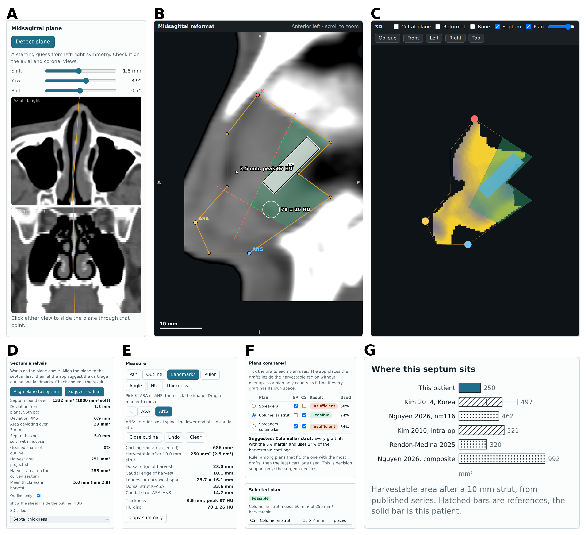

# Septal Cartilage 3D

A browser-based research and teaching tool that helps plan septal cartilage graft harvest from CT: it aligns a reformat plane to the septum, suggests the cartilage outline and L-strut landmarks, measures the harvestable cartilage, places candidate grafts inside it and compares plans. Everything runs in the browser; no scan is uploaded.

> **Research and teaching tool, not a medical device.** It has not been validated against surgeons' intraoperative decisions. Every measurement and suggestion must be checked by a clinician against the images.



## What it does

- **Reads CT** as uncompressed DICOM (loose files or a ZIP) or NRRD (raw or gzip), axial and aligned to the scanner axes.
- **Aligns the reformat plane to the septum.** The first guess comes from left-right symmetry; *Align plane to septum* then fits a plane to the thin tissue sheet with air on both sides.
- **Suggests an outline and the landmarks** K, ASA and ANS from the soft part of that sheet. You can drag every point.
- **L-strut and harvest area.** Strut lines are moved inward by a chosen width (6–16 mm); the rest is the harvestable cartilage, reported as projected area and as area on the curved septum, with dorsal and caudal edge lengths and spans.
- **Septum analysis:** deviation from the plane, septal thickness (with mucosa), ossified share of the outline.
- **Graft placement and plan comparison.** Grafts are rectangles placed without overlap inside the harvestable region; five plans are compared (Feasible, Borderline, Insufficient) and one is suggested by a stated rule.
- **Measurement tools:** ruler, angle, HU disc, thickness at a point.
- **3D view:** bone surface, septal sheet coloured by deviation or thickness, harvestable region and placed grafts, with layer toggles.
- **Print overlay** (black and white, hatched) for figures.

## Quick start

1. Open `index.html` in a current browser (needs internet for three.js, JSZip and the font), or open `index.offline.html`, which uses the copies in `vendor/` and works offline. Serving the folder from GitHub Pages also works.
2. Go to **Patient** and load `sample/NasalSeg_P101_img.nrrd` (or your own DICOM/NRRD).
3. Press **Align plane to septum**, then **Suggest outline**. Check and drag the outline and the landmarks.
4. Open **Planning** to compare plans, change the L-strut width and the fit margin, and see where each graft is placed.

Graft sizes: spreader grafts (25 × 3 mm, pair) and columellar strut (15 × 4 mm) follow the ranges in the literature cited in the Notes tab. **Septal extension and tympanoplasty sizes are placeholders; set them to the sizes you use.** The fit margin is a setting of the tool, not a published threshold.

## How well does it work?

Tested on four cases of the NasalSeg dataset against a plane and outline derived from the dataset's nasal-cavity labels (`validation/`):

| Case | Plane normal difference | Outline overlap (IoU) |
|---|---|---|
| P101 | 1.5° | 0.64 |
| P050 | 0.8° | 0.59 |
| P130 | 0.6° | 0.42 |
| P094 | 0.4° | 0.74 |

The suggested outline is conservative: it is usually smaller than the label-based reference, and the suggested L-strut landmarks are a starting point to edit. NasalSeg has no septal cartilage labels and its slices are 1.5 mm thick, so these numbers show that the pipeline runs and roughly agrees with a label-based reference, not that it measures cartilage accurately. Some consecutive NasalSeg cases (for example P072 and P073) have identical measurements and appear to be duplicates.

## Limits

- One plane, so areas are projected (the curved-septum area adds the local slope).
- Septal thickness includes mucosa and partial volume.
- Compressed DICOM and non-axial scans are not read.
- No automatic segmentation by a trained model; the suggestions are rule-based.
- Not validated against surgeons' decisions or against intraoperative measurements.

Details of every step are in [`docs/METHODS.md`](docs/METHODS.md).

## Repository layout

```
index.html            app (loads three.js and JSZip from CDNs)
index.offline.html    same app using vendor/ (works offline)
vendor/               three.js r128, OrbitControls, JSZip 3.10.1 (MIT)
sample/               one CT case from NasalSeg (CC BY 4.0)
docs/                 METHODS.md and figures made from the app
validation/           scripts that compare the app with NasalSeg label-based references
```

## Releases and DOI

Tagged releases are archived on Zenodo, which gives each version a DOI. Cite the version you used. [DOI badge to be added after the first release.]

## Privacy

Scans are read and processed in the browser and are not uploaded. `index.html` loads three.js, JSZip and a web font from public CDNs; use `index.offline.html` for fully local use with no network requests.

## Citing

See `CITATION.cff`. If you use the sample or the validation, also cite NasalSeg: Zhang Y, et al. *NasalSeg: a dataset for automatic segmentation of nasal cavity and paranasal sinuses from 3D CT images.* Sci Data 2024. doi:10.1038/s41597-024-04176-1 (data: doi:10.5281/zenodo.13893419, CC BY 4.0).

## Licence

Code: MIT (`LICENSE`). Sample CT: CC BY 4.0 (see `NOTICE.md`). Bundled libraries keep their own licences.

Developed with the assistance of Claude (Anthropic); reviewed by the authors.

---

## Tóm tắt (tiếng Việt)

Công cụ chạy ngay trong trình duyệt, hỗ trợ lập kế hoạch lấy sụn vách ngăn làm graft từ CT: tự căn mặt phẳng theo vách, đề xuất viền và ba mốc L-strut, tính diện tích sụn lấy được, xếp graft vào vùng đó và so sánh nhiều kế hoạch. Dữ liệu không rời máy. **Chỉ dùng cho nghiên cứu và giảng dạy, không phải thiết bị y tế**, chưa được kiểm chứng với quyết định của phẫu thuật viên. Mở `index.html` hoặc `index.offline.html`, vào tab Patient, nạp file trong `sample/`, bấm *Align plane to septum* rồi *Suggest outline*. Cỡ septal extension và tympanoplasty chỉ là số tạm; hãy thay bằng cỡ bạn dùng.
